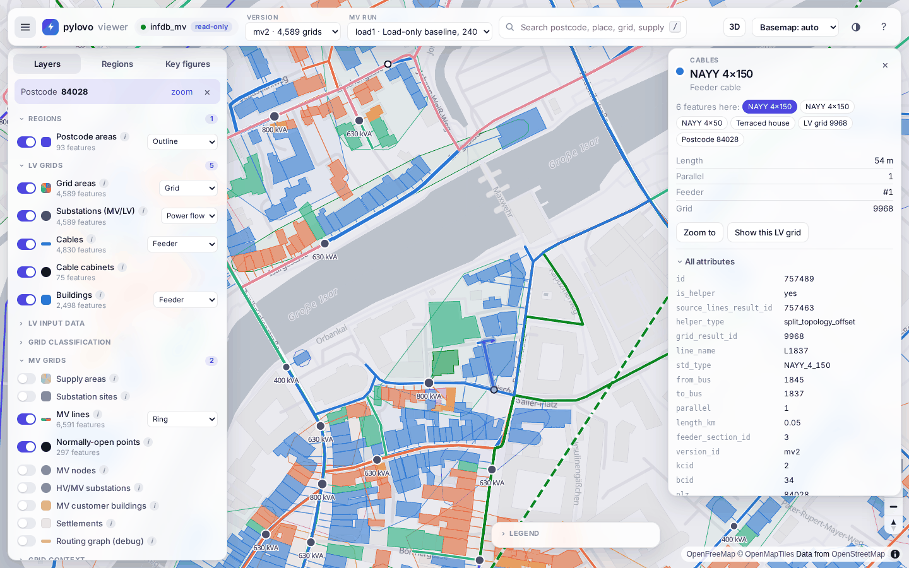

.. image:: docs/source/images/logo.png
    :width: 500
    :alt: pylovo logo

**Synthetic low-voltage distribution grids from open data.**

|badge_license| |badge_documentation|

`Documentation <https://pylovo.readthedocs.io/en/latest/>`_ · `Quickstart <https://pylovo.readthedocs.io/en/latest/getting_started/quickstart.html>`_

pylovo (PYthon tool for LOw-VOltage distribution grid generation) generates synthetic
low-voltage (LV) distribution grids for German postcode areas. It places transformers, routes
radial feeders along the streets, connects every supplied building with a service cable, sizes
all equipment with coincidence factors and voltage-drop limits, and checks every grid with a
power flow. The grids are stored as `pandapower <https://www.pandapower.org/>`_ networks and as
GIS tables in PostgreSQL/PostGIS.

    Generated LV grids in pylovo-viewer: cables and 3D buildings coloured by grid, one feeder section
    selected (test region from open data; basemap OpenFreeMap © OpenMapTiles, map data
    © OpenStreetMap contributors, ODbL).

Key features
------------

* **Open data** -- LoD2 buildings, Zensus 2022 households, basemap streets and postcode polygons
  from the `InfDB <https://github.com/tum-ens/InfDB>`_ (or from files); transformer positions from
  OpenStreetMap, LoD2 station buildings, DSO lists or manual edits.
* **Brownfield and greenfield grids** -- existing transformers as grid roots, load- and
  distance-constrained clustering and transformer placement for the rest.
* **Electrical dimensioning** -- category-specific coincidence, uniform feeder sections, feeder
  and service voltage-drop limits, power-flow check with stored diagnostics.
* **Reproducible versions** -- every run belongs to a ``VERSION_ID`` whose parameters are frozen in
  the database.
* **Medium-voltage grids** -- an optional stage plans the MV grid of an LV version: open rings along
  the streets from the HV/MV substations, checked with pandapower in the load case and both (n-1)
  cases (``pylovo-mv``, ``pylovo-generate --mv``).
* **From one postcode to many** -- regions by postcode (PLZ) or municipality (AGS), parallel runs.
* **Grid classification** -- group the generated grids into representative grid types
  (``pylovo-classify``, see the
  `classification guide <https://pylovo.readthedocs.io/en/latest/user_guide/classification.html>`_).
* **Analysis and visualisation** -- key figures per postcode and grid, the read-only map viewer
  ``pylovo-viewer`` (see the `map viewer guide
  <https://pylovo.readthedocs.io/en/latest/user_guide/viewer.html>`_), QGIS templates, CSV and
  pandapower JSON export, plotting helpers, and a headless HTTP API for browser clients and scripts.

The shipped data cover Bavaria; other regions need the corresponding InfDB data and transformer
download.

Quick start
-----------

Requirements: Linux or WSL2, Python 3.12 or 3.13, `uv <https://docs.astral.sh/uv/>`_, GDAL (``ogr2ogr``)
and a PostgreSQL database (version 15 or newer) with PostGIS and pgRouting 3.8 or newer -- in the
recommended setup the InfDB database with processed buildings and streets (see the
`InfDB documentation <https://tum-ens.github.io/InfDB/usage/>`_).

.. code-block:: bash

   git clone https://github.com/tum-ens/pylovo.git
   cd pylovo
   uv sync                                   # add --extra plots for the plotting helpers
   cp .env.example .env                      # enter the database connection

Without a checkout the wheel works as well: ``pip install pylovo`` into a virtual environment, put the ``.env`` into
your project directory and run the commands from there. The wheel ships the default configuration and the reference
data that the setup needs (see the
`installation page <https://pylovo.readthedocs.io/en/latest/getting_started/installation.html#install-wheel>`_).

Set up the schema ``pylovo`` and generate grids (run the commands from the repository root):

.. code-block:: bash

   uv run pylovo-setup                       # creates or migrates the schema without deleting grids
   uv run pylovo-generate --plz 80803        # one postcode
   uv run pylovo-generate --ags 09162000     # all postcodes of a municipality
   uv run pylovo-analyze --plz 80803 --all   # key figures

``pylovo-setup reset --database NAME`` explicitly deletes all PyLovo results; normal setup migrates in place. The
grid parameters are in ``config/config_generation_lv.yaml``; use a new ``VERSION_ID`` when you change
them. All commands and options are described in the
`command-line reference <https://pylovo.readthedocs.io/en/latest/user_guide/cli.html>`_.

Map viewer
----------

``pylovo-viewer`` shows the database of your ``.env`` as an interactive map with one switch per
level: the 110-380 kV grid of Germany (eTraGo), the MV grids and the LV grids, with all attributes on
click, colour modes, a legend, key figures and 3D LoD2 buildings. It only reads the database. See the
`map viewer guide <https://pylovo.readthedocs.io/en/latest/user_guide/viewer.html>`_.

.. code-block:: bash

   uv sync --extra viewer
   uv run --extra viewer pylovo-viewer       # http://127.0.0.1:8770/

HTTP API
--------

``pylovo-api`` is the headless HTTP API of pylovo for browser clients and scripts: database setup,
regions, input data, transformer editing, configuration, generation, analysis and export jobs with
live logs, results (statistics, grid details, power flow), load editing and diagnostics.
``api/README.md`` lists the endpoints.

.. code-block:: bash

   uv sync --extra api
   uv run --extra api pylovo-api             # http://127.0.0.1:8765/api/health

Scientific background
---------------------

The methodology is described in `Reveron Baecker et al. (2025): Generation of low-voltage synthetic
grid data for energy system modeling with the pylovo tool
<https://doi.org/10.1016/j.segan.2024.101617>`_.

License
-------

| The code of this repository is licensed under the **MIT License** (MIT).
| See `LICENSE.txt <LICENSE.txt>`_ for rights and obligations.
| The data files in the repository are not covered by the MIT License: see `DATA_LICENSES.md <DATA_LICENSES.md>`_.
| Copyright: `pylovo <https://github.com/tum-ens/pylovo/>`_ © TUM ENS | `MIT <LICENSE.txt>`_

Citation
--------

| If you use this code in a scientific publication, please cite the following publication:
| * Reveron Baecker et al. (2025): `Generation of low-voltage synthetic grid data for energy system modeling with the pylovo tool <https://doi.org/10.1016/j.segan.2024.101617>`_

.. |badge_license| image:: https://img.shields.io/github/license/tum-ens/pylovo
    :target: LICENSE.txt
    :alt: License

.. |badge_documentation| image:: https://readthedocs.org/projects/pylovo/badge/?version=latest
    :target: https://pylovo.readthedocs.io/en/latest/
    :alt: Documentation
